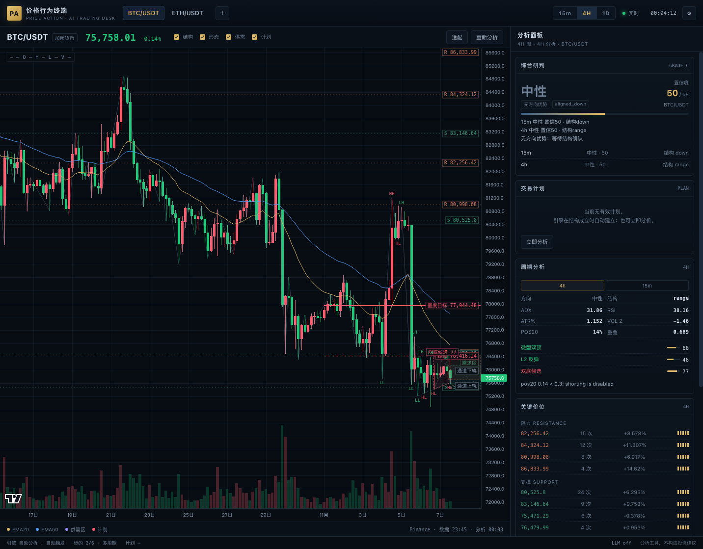

# naked-k-analysis · 价格行为 AI 交易面板

零依赖（Python 标准库 + SQLite + 本地 vendor 图表）的裸K价格行为终端：多市场数据、双周期联合分析、可追踪的交易计划生命周期、图表几何标注、按标的参数库，以及可选的 LLM 解读与受限参数迭代。

[](https://github.com/William-Trader/naked-k-analysis/actions/workflows/ci.yml)
[](https://www.python.org/)
[](CHANGELOG.md)
[](#工程约束)
[](LICENSE)
[-orange.svg)](WATERMARK.md)

> **许可 / License**: [Personal Use & Group Exchange License](LICENSE).
> **仅供个人使用与团体交流；禁止商业用途。**
> **For personal use and group exchange only. Commercial use is prohibited.**

> 分析工具，不构成投资建议。项目不执行交易、不承诺收益；回测没有正期望时会如实写明。

---

## 界面

左：K 线 / EMA / 成交量 / 结构摆动 / 供需区 / 通道 / 形态 / 交易计划线。
右：综合研判、计划卡、周期分析、关键价位、AI 解读、计划事件、数据与引擎状态。



---

## 核心能力

### 1. 多市场，按需接入

| 市场 | 数据源 | 标的示例 | 周期 |
|---|---|---|---|
| 加密货币 | Binance public data | BTCUSDT / ETHUSDT / SOL / BNB / XRP | 15m / 1h / 4h / 1d |
| 大宗商品 | Yahoo Finance chart | GC / SI / HG / CL / NG / ZC / ZS | 15m / 1h / 4h / 1d |
| 海外指数/期货 | Yahoo Finance chart | SPX / NDX / DJI / ES / NQ / YM | 15m / 1h / 4h / 1d |
| 国内期货 | 新浪财经 JSONP | RB0 / I0 / CU0 / AU0 / SC0 / MA0 / TA0 | 15m / 1h / 4h / 1d |

默认只分析 **BTC / ETH**；其余标的保留接入能力，在「系统设置 → 标的池」中选用后才拉取。最大同时分析标的数可配置（默认 6，上限 24）。

### 2. 双周期联合分析

- 默认 **4h（环境/偏向）+ 15m（执行/时机）**，可在设置中切换为单周期。
- 组合规则保守：周期共振才提高置信度；方向冲突直接降为中性并限制置信度；4h 反向可否决快速周期。
- 每个周期独立输出：方向、置信度、等级、结构状态、ADX/RSI/ATR/Volume Z/位置、形态、关键位。

### 3. 交易计划生命周期（不是单次信号）

```
armed(待触发) -> triggered(到触发区) -> confirmed(确认) -> managing(持仓管理) -> closed(结束)
      |                 |                     |
      +-----------------+---------------------+--> void(失效/超时/手动作废)
```

- 计划由确定性引擎建立：方向 + 触发价 + 止损 + 目标1/2 + R:R + 失效条件 + TTL + 分析快照。
- **到价不等于入场**：价格触及触发价后，引擎自动重跑一次完整分析并执行确认门（4h 结构、MTF、regime、量能、重叠），通过才发「确认」，不通过则作废。
- 触发前 4h 结构反转 → 计划自动作废，不带着死计划等价格。
- 每次状态迁移写入 append-only `plan_events`，带幂等键；进程重启不会重复推送。
- 达到目标1自动移保本；目标2/止损/超时结束；所有结果进入计划台账。

### 4. 图表价格行为标注

服务端 `nakedk/annotations.py` 输出可绘制几何，前端用 Lightweight Charts + 透明 Canvas 叠加：

- ATR ZigZag 摆动点与 HH / HL / LH / LL 标签；
- 支撑/阻力聚类（触碰次数 + 强度）；
- 趋势通道（枢轴最小二乘拟合 + R² 过滤 + 右延）；
- 供需区、突破基座；
- 双底/双顶、头肩、三角形、楔形、旗形、杯柄等形态多边形 + 颈线 + 量度目标；
- 当前计划的触发 / 止损 / 目标1 / 目标2 / 风险区。

### 5. 每个标的一套参数

`state/symbol_profiles.json` 是独立的标的参数库，保存每个标的的覆盖值、来源（manual / llm）、版本和历史。分析时合并到全局默认值；改动只影响该标的。

可调项包括 ADX 门槛、区间位置门禁、重叠上限、量能确认、止损/目标 ATR、计划最低置信度、最低 R:R、TTL 等；LLM 建议受硬边界 `symbol_params.BOUNDS` 限制。

### 6. LLM（可选，不参与定价）

支持任意 OpenAI 兼容接口（DeepSeek / OpenAI / 通义千问 / Moonshot / Ollama / vLLM）。

- **配置方式**：面板右上角 `⚙ → LLM → API Key` 可直接输入（保存到本机 `state/llm.key`，0600，不回显）；也可复制 `config/llm.example.json` 为 `config/llm.local.json`，把 `api_key_env` 指向保存 key 的环境变量，或用 `NK_LLM_BASE` / `NK_LLM_MODEL` / `NK_LLM_KEY` 覆盖。详见 [docs/LLM.md](docs/LLM.md)。
- **图表解读**：输入确定性引擎输出，输出一句话结论、情景、失效条件与风险提示；不生成价位。
- **受限参数迭代**：仅在计划样本充足（总数 ≥20、已结束 ≥10）时提出 ≤2 个参数的小幅调整；越界、非数字、未知键一律拒绝；每天最多一次。
- **自检**：`python3 scripts/llm_check.py` 查看配置；加 `--ping` 做一次真实请求。
- 未配置 key 时返回 `enabled:false`，系统完整可用；本地 Ollama 端点不要求 key。

### 7. 推送与实时

- 计划状态迁移写入 `outbox`，由 `beagle/push.py` 通过 OpenClaw qqbot 通道推送；设置中开启「QQ 推送」并填写群 target（或环境变量 `BEAGLE_QQ_TARGET`）。
- 推送是简单可执行格式：`标的 · 周期 · 方向` / `状态` / `操作` / `触发/止损/目标` / `依据` / `风控` / `数据 + 免责声明`；只推 `确认 / 目标达成 / 止损 / 失效`，不推心跳。
- 本机 OpenClaw 没有 qqbot 时，设置 `push_ssh`（例如 `qsp`）通过已配置 qqbot 的远程网关发送；命令行参数逐项 quote，不做 shell 拼接。
- 触发价到达后先自动重跑分析，确认通过才推送「可执行」建议；未通过推送「结构失效」，不裸触发。
- 前端通过 SSE `/api/stream` 接收 symbol / plan / settings 事件，同时保留 25s 轮询兜底。

### 8. 自动再分析（到价触发）

引擎除了按 TTL 刷新，还会监控当前价格与支撑/阻力、形态颈线、量度目标的距离；进入 `0.35 × ATR` 区间且超过冷却时间时，自动对该标的执行下一次分析。这样「价格到达可能的关键位」会触发新的判断，而不是等固定轮询。

---

## 架构

```
dashboard/
  index.html            shell only
  styles.css            professional dark terminal
  app/
    main.js             boot / routing / SSE / polling
    chart.js            Lightweight Charts + canvas annotation layer
    panels.js           right-hand modules
    settings.js         symbol pool / intervals / automation / params
    api.js  store.js  format.js

nakedk/
  analysis.py           one symbol -> multi-interval chart-ready payload
  markets.py            Binance / Yahoo / Sina normalised to one kline shape
  features.py           EMA / ADX / RSI / ATR / volatility / swings
  structure.py          ZigZag / HH-HL-LH-LL / BOS / CHoCH
  patterns.py           pattern candidates + scoring
  annotations.py        drawable geometry (levels / zones / channels / polygons)
  multi.py              4h + 15m combination
  plans.py              plan lifecycle state machine (pure)
  symbol_params.py      per-instrument parameter library + bounds
  llm.py                optional commentary + guarded tuning
  params.py             global defaults

beagle/
  engine.py             analyse -> arm -> trigger -> confirm -> outbox
  store.py              SQLite plans / plan_events / outbox / legacy events
  push.py               QQ outbox delivery
  monitor.py            legacy 1m/5m event monitor
```

运行时分两条循环：

- **analysis**：按 TTL / 到价触发，计算特征并刷新计划（重）；
- **trigger**：每 20s 只比较价格与计划价位（轻），触发后才做一次完整分析确认。

---

## 快速开始

```bash
git clone https://github.com/William-Trader/naked-k-analysis.git
cd naked-k-analysis

# 终端（默认 8080）
python3 dashboard/server.py
# 或指定端口
PORT=8099 python3 dashboard/server.py

# 打开
open http://127.0.0.1:8080/
```

要求 Python 3.10+，无需 pip install。首次启动自动建 `beagle.db` 与 `state/`。

独立运行自动化引擎（与 dashboard 二选一，或共用同一个 SQLite）：

```bash
python3 -m beagle.engine
```

CLI：

```bash
PYTHONPATH=. python3 -m nakedk fetch BTCUSDT XAU
PYTHONPATH=. python3 -m nakedk signal XAU
PYTHONPATH=. python3 -m nakedk knowledge '突破回踩'
python3 -m unittest discover -s tests
```

### 环境变量

| 变量 | 作用 | 默认 |
|---|---|---|
| `PORT` | dashboard 端口 | `8080` |
| `BEAGLE_DB` | SQLite 路径 | `<repo>/beagle.db` |
| `NK_SETTINGS` | 设置文件 | `<repo>/state/settings.json` |
| `NK_SYMBOL_PROFILES` | 标的参数库 | `<repo>/state/symbol_profiles.json` |
| `NK_DASH_TOKEN` | 可选 Bearer/查询 token | 空（不鉴权） |
| `NK_LLM_CONFIG` | LLM 配置文件 | `config/llm.local.json` |
| `NK_LLM_KEY` | LLM API key（优先级最高） | 空（关闭） |
| `NK_LLM_KEY_FILE` | 面板输入的 key 文件 | `state/llm.key` |
| `NK_LLM_BASE` | OpenAI 兼容 base URL | 配置文件 / `https://api.openai.com/v1` |
| `NK_LLM_MODEL` | 模型名 | 配置文件 / `gpt-4o-mini` |
| `BEAGLE_QQ_TARGET` | qqbot 推送目标 | 空（不推） |
| `BEAGLE_PUSH_SSH` | 通过远程网关发送的 SSH host | 空（本机） |

---

## API

| Endpoint | 说明 |
|---|---|
| `GET /api/health` | 服务/引擎/LLM/计划统计 |
| `GET /api/universe` | 全部标的、市场、provider、周期 |
| `GET /api/overview?symbols=&intervals=` | 多标的概览 |
| `GET /api/symbol?symbol=&force=` | 单标的完整分析 + 计划 + 事件 |
| `GET /api/plans` | 开放计划 / 历史 / 事件 / 统计 |
| `POST /api/analyze` | 立即重算一个标的 |
| `POST /api/plan/action` | 手动作废计划 |
| `GET/POST /api/settings` | 标的池 / 周期 / 自动化 / LLM 开关 |
| `GET/POST /api/symbol-params` | 单标的参数读写、LLM 建议、回滚 |
| `GET /api/llm/status` | LLM 是否可用 |
| `POST /api/llm/annotate` | 生成图表解读 |
| `POST /api/llm/optimize` | 受限参数建议（可显式 apply） |
| `GET /api/stream` | SSE 实时事件 |
| `GET /api/knowledge` | 知识库模块/原文 |

---

## 准确度与边界（如实）

本项目此前的实测结论仍然有效：

- BTC/ETH 近 150 天、900 根 4h、12bp 成本：基线命中 38.6% / 42.2%，平均净 −0.105% / −0.078%，3 折全负；
- 加入高重叠硬否决与量能确认后：47.6% / 54.1%，平均净 −0.033% / +0.206%，正收益折 2/3，第 3 折仍负；
- **仍不宣称正期望**。计划状态与置信度是描述性质量分级，不是概率承诺。

因此系统把「不交易」当作合法输出：中性/冲突时不出计划，置信不足时不发确认，结构失效时立即作废。计划台账（`plan_events`）用于后续按 setup / regime / 周期分桶复盘，而不是用单次结果讲故事。

---

## 工程约束

1. **零第三方依赖**：Python 标准库 + SQLite；图表库本地 vendor（Apache 2.0，见 `NOTICE.md`）。
2. **单一分析路径**：dashboard、CLI、引擎都调用 `nakedk/analysis.py`，不各自推导。
3. **单一计划事实源**：前端与 QQ 都读同一个 plan / plan_event，避免「群里说 A、页面说 B」。
4. **幂等**：`plan_events.idempotency_key` + `outbox(plan_event_id, channel)` 唯一约束。
5. **门禁只做减法**：新增过滤必须有实测依据；不因「看起来更好」而放宽。
6. **测试只增不减**：237 个单测通过；新增模块带纯函数测试。

---

## 致谢

价格行为方法论来自 Al Brooks（趋势/区间/反转三部曲、Always-In、Setup）、YTC / Lance Beggs、许佳聪《裸K线交易法》、胡云生《裸K线技术分析与交易》、崔海军《裸K线操盘技法》、陈浩筹码分布、Adam Grimes、Wyckoff。项目只做蒸馏与工程化，原著版权归原作者。

---

## License

[Personal Use & Group Exchange License](LICENSE)。仅供个人使用与团体交流；禁止商业用途。
所有核心源文件带 `WM: NKA-XXXXXXXX` 水印，清单见 [WATERMARK.md](WATERMARK.md)。
