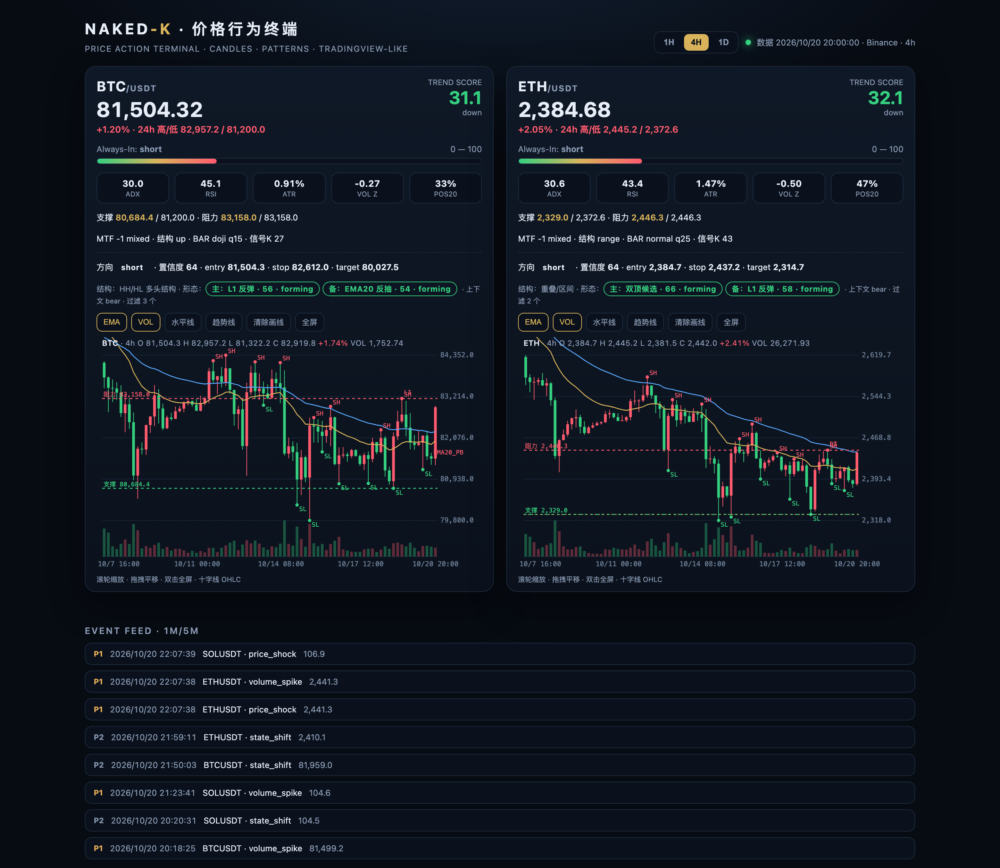
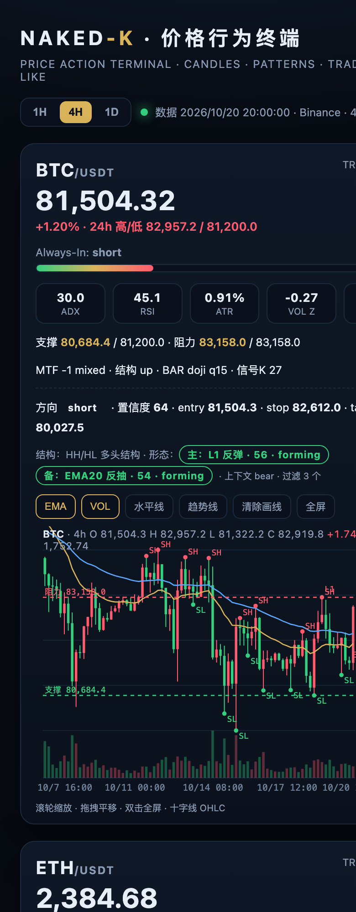

# naked-k-analysis

**Zero-dependency price-action analysis and multi-frequency monitoring for crypto markets.**

[](https://github.com/William-Trader/naked-k-analysis/actions/workflows/ci.yml)
[](https://www.python.org/)
[](#engineering)
[](LICENSE)
[-orange.svg)](WATERMARK.md)

> **许可 / License**: [PolyForm Noncommercial License 1.0.0](LICENSE).
> **仅供价格行为交易者研究使用；禁止任何商业用途；违法必究。**
> **For price-action traders and researchers only. Commercial use is prohibited. Violators will be prosecuted.**

---

## 中文

### 概览

naked-k-analysis 是一个**零依赖的价格行为（裸K）分析与多频监测工具包**。它不做交易执行，也不承诺预测；它把 Al Brooks 体系蒸馏成可执行规则，输出可审阅的结构化分析。

系统由三层组成：

- **`nakedk`**：确定性分析引擎（特征、趋势评分、状态、信号、评分、历史回放）。
- **`beagle`**：多频监测服务（1m/5m 事件、SQLite 状态、去重/冷却/限流、推送桥）。
- **`knowledge`**：9 个价格行为知识模块（市场结构、逐K、Setup、主力、决策树、输出模板、OCR 提纯、Al Brooks 深度框架、评审标准）。

### 功能



- **六层分析链**：单根K线编码 → 结构标注（BOS/CHoCH）→ 位置上下文 → 量价关系 → 多周期共振 → 信号K质量，逐层输出机器可读行，结论可追溯。
- **单根K线编码**：实体占比、收盘位置、上下影线、range/body 相对 ATR、与前一根重叠、bar 类型、0–100 清晰度。
- **结构标注**：ATR ZigZag 摆动点、HH/HL/LH/LL、BOS/CHoCH、结构状态机（up/down/range/transition）。
- **多周期对齐**：1d/4h/1h 三档符号，alignment −3…+3；方向与对齐冲突的形态直接降权。
- **量价与位置**：近似 VPOC/价值区/HVN、effort-vs-result、量价背离；距摆动位 ATR 距离、区间边缘分区、前日高低。
- **信号K六维打分**：收盘位置、实体、影线、前一根跟随、位置、量能；低于 40 视为无效信号K。
- **趋势评分 0–100**：EMA 排列 + ADX 强度 + 区间位置 + 24h 动量；输出 `TREND|...`。
- **多频监测与提醒**：1m/5m 价格冲击、量能异常、区间突破、状态切换、资金费率；P0/P1/P2 分级，冷却/静默/限流，失败重试与死信。
- **反馈闭环**：信号落库 → 到期评分（收益、命中、MFE/MAE、盘中先触止损还是目标）→ 分桶复盘（Wilson 区间、样本门槛）→ 自适应权重。
- **系统自迭代**：按形态实测边缘调整置信度权重，单次最多 ±0.08、区间 [0.70, 1.30]、连续两次劣化自动隔离，全部变更留审计日志。
- **仪表盘**：暗色终端 UI，双币卡片含 MTF/结构/BAR/信号K 徽章、趋势评分、关键位、方向与三价位、K线图（EMA/支撑阻力/摆动点/成交量）、事件流；支持滚轮缩放、拖拽、画线、全屏。
- **工程化**：零依赖、80 单测、GitHub Actions、Dockerfile、Makefile、systemd、一键部署。

### 六层分析链

| 层 | 模块 | 输出 |
|---|---|---|
| 单根K | `nakedk/bars.py` | `BAR` 行 |
| 结构 | `nakedk/structure.py` | `STRUCT` 行 |
| 多周期 | `nakedk/mtf.py` | `MTF` 行 |
| 位置 | `nakedk/location.py` | `LOC` 行 |
| 量价 | `nakedk/volume.py` | `VOLP` 行 |
| 信号K | `nakedk/signalbar.py` | `SIGBAR` 行 |

### 反馈闭环与自迭代

```bash
python -m beagle backfill --days 120   # 生成带标签的历史信号（source=engine_backfill）
python -m beagle score                 # 到期评分：收益/命中/MFE/MAE/盘中先触
python -m beagle review --apply        # 分桶复盘 + 写入自适应权重
```

实测（481 条回填样本，非实盘业绩）：

```
样本: 481 | 命中率 49.5% | Wilson [45.0, 53.9] | 期望 -0.009% | MFE 0.72 / MAE -0.66
multipliers: DB=0.9478 DT=1.0774 IHS=0.9244 L1=0.92 L2=1.0468
```

> 回填样本用于验证链路与统计方法，不代表任何实盘收益；自适应权重有界、可回滚，每次变更记录在 `state/adaptive.json`。

### 移动端




### 系统组成

| 路径 | 作用 |
|---|---|
| `nakedk/features.py` | EMA、ADX、RSI、ATR、量能 z、摆动点、区间位置 |
| `nakedk/bars.py` | 单根K线编码（实体/影线/收盘位置/类型/清晰度） |
| `nakedk/structure.py` | ATR ZigZag、HH/HL/LH/LL、BOS/CHoCH、结构状态 |
| `nakedk/mtf.py` | 1d/4h/1h 多周期对齐 |
| `nakedk/signalbar.py` | 信号K六维打分 |
| `nakedk/volume.py` | VPOC/价值区、effort-vs-result、量价背离 |
| `nakedk/location.py` | 距摆动位 ATR、区间边缘、前日高低 |
| `nakedk/stats.py` | Wilson 区间、分桶统计、样本门槛 |
| `nakedk/calibration.py` | 置信度分桶校准 |
| `nakedk/trend.py` | 0–100 趋势评分 + Always-In |
| `nakedk/signals.py` | 确定性方向 + 防线 + 止损/目标 |
| `nakedk/fetch.py` | Binance 公共数据 + 文本摘要 + TREND 行 |
| `nakedk/score.py` | 信号结果回算 |
| `nakedk/backtest.py` | 历史回放（内部研究） |
| `beagle/detect.py` | 6 类事件检测 |
| `beagle/monitor.py` | 快照 → 特征 → 事件 → SQLite |
| `beagle/push.py` | 待推送告警 → QQ |
| `beagle/replay.py` | 历史事件校准 |
| `beagle/review.py` | 分桶复盘 + 自适应权重写回 |
| `beagle/adaptive.py` | 有界、可审计的权重调整 |
| `dashboard/` | 零依赖仪表盘 API + 暗色前端 |
| `knowledge/` | 9 个价格行为模块 |
| `deploy/` | systemd 单元：monitor / push / dashboard |
| `bootstrap.sh` | 一键部署 |
| `AGENT-SETUP.md` | 给 Agent 的一键设置说明 |

### 快速开始（一键部署）

```bash
git clone https://github.com/William-Trader/naked-k-analysis.git
cd naked-k-analysis
bash bootstrap.sh
```

手动运行：

```bash
python3 -m unittest discover -s tests
python3 -m nakedk fetch BTCUSDT ETHUSDT
python3 -m nakedk signal BTCUSDT ETHUSDT
PYTHONPATH=. PORT=8080 python3 dashboard/server.py
```

### QQ 机器人（默认集成）

默认推送通道是 **OpenClaw qqbot**。配置：

1. 复制 `config/openclaw.example.json` 到 `~/.openclaw/openclaw.json`，填入 `channels.qqbot.appId`、`channels.qqbot.clientSecret`、`gateway.auth.token`。
2. 在 `.beagle.env` 填 `BEAGLE_QQ_TARGET=group:<群 openid>`（600 权限，不进仓库）。
3. 4h 简报：`bash scripts/pa_cron_setup.sh`（先替换群 openid 占位符）。
4. 5 分钟事件推送：`beagle-push.timer`。
5. 聊天「分析BTC」：走 `pa_fetch` + `08/09` → `06` 模板，不再使用旧的 13 智能体流程。

### 自动分析与提醒

| 频率 | 任务 | 输出 |
|---|---|---|
| 1m | 价格冲击 / 量能异常 | P1/P2 事件 |
| 5m | 区间/关键位突破 | P1 事件 |
| 15m | 状态切换 / 主力迹象 | P2 事件 |
| 4h | 完整简报 | QQ 群 |
| 事件 | P0 极端行情 | 群 + 私聊 |

提醒策略：P0 立即；P1 5 分钟聚合；P2 只进 4h 简报；23:00–08:00 只推 P0；冷却 60/120/360 分钟；全局限流 6 条/小时、20 条/天。

### 趋势评分

`nakedk/trend.py` 输出 0–100 分：

- EMA20/EMA50 排列 + 价格位置（±20）
- ADX 强度（±20）
- 区间位置 pos20（±10）
- 24h 动量（±10）

评分是**描述性指标**，不是收益预测；≥60 视为多头结构，≤40 视为空头结构，中间为中性。

### 仪表盘

```bash
PYTHONPATH=. PORT=8080 python3 dashboard/server.py
```

访问 `http://<host>:8080/`：暗色终端 UI，BTC/ETH 双卡，趋势评分、Always-In、ADX/RSI/ATR/vol_z/pos20、关键位、方向/entry/stop/target、4h 走势线、1m/5m 事件流；每 60 秒刷新。

### 扩展数据源

本工具的数据层与市场无关。价格行为交易者可以让 Agent 自行修改 `nakedk/fetch.py` 与 `beagle/config.py`，接入其他数据源（其他交易所、股票/期货/外汇 API），分析更多市场。

可行范围取决于两点：

- **服务器性能**：1m 轮询的品种数、K线回补与回放会消耗 CPU/内存；
- **数据源强度**：速率限制、历史深度、字段完整性与稳定性。

建议先加一个市场、跑通 `nakedk fetch`，再逐步扩展 watchlist；不要把全市场一次性塞进 1m 轮询。

### 知识库

| 文件 | 内容 |
|---|---|
| `01-market-structure.md` | 市场周期、趋势/区间/通道、状态机 |
| `02-bar-reading.md` | 信号K/入场K、K线类型、买压卖压、订单流 |
| `03-setups.md` | H1-H4/L1-L4、DB/DT、楔形、最终旗形、MTR、头肩、BLSHS |
| `04-smart-money.md` | 吸筹/派发、筹码形态、Stop run/吸收/背离 |
| `05-decision-tree.md` | 9 步决策流程 + 硬规则 |
| `06-output-template.md` | 输出模板 + 示例 |
| `07-ocr-distilled.md` | 扫描书 OCR 提纯 |
| `08-albrooks-deep.md` | Al Brooks 深度框架 + 12 问 |
| `09-review-rubric.md` | 输出评审标准（60 + 20 分） |

### 架构

```
L0 数据      Binance 1m/5m/15m/1h/4h/1d + 资金费率/FGI
L1 特征      EMA/ADX/RSI/ATR/量能 z/区间/摆动点
L2 事件      价格冲击/量能异常/区间突破/状态切换/资金费率
L3 分析      确定性 stance + 趋势评分 + 可选 LLM 叙述
L4 决策      P0/P1/P2 + entry/stop/target + 置信度
L5 投递      OpenClaw qqbot / 任意 webhook；去重/冷却/静默/限流
L6 反馈      SIGNAL → 结果评分 → 校准
```

完整设计：[docs/ARCHITECTURE.md](docs/ARCHITECTURE.md)。

### 工程化

- 零第三方依赖（Python 标准库 + SQLite）
- 33 个单测；GitHub Actions（3.10/3.12/3.13）
- Dockerfile、Makefile、systemd 单元
- `bootstrap.sh` 一键部署；`AGENT-SETUP.md` 给 Agent 的逐步说明

### 许可与免责

- **PolyForm Noncommercial License 1.0.0**：source-available，**禁止商用**。
- **仅供价格行为交易者研究使用**；不得转售、再许可、嵌入付费产品。
- **违法必究**：未经授权的商业使用将依法追究。
- 本工具不执行交易，不构成投资建议；不声明任何历史业绩。

---

## English

### Overview


**What it does**: encodes every candle, labels market structure (BOS/CHoCH), scores the signal bar on six dimensions, checks 1d/4h/1h alignment, adds volume profile and location context, then records every signal, scores it at the horizon (including MFE/MAE and whether the stop or the target was touched first), and adjusts per-setup weights within hard bounds.

naked-k-analysis is a **zero-dependency price-action analysis and multi-frequency monitoring toolkit**. It does not execute trades and makes no prediction claims. It distils the Al Brooks framework into executable rules and produces structured, reviewable analysis.

It has three layers:

- **`nakedk`** — deterministic analysis engine (features, trend score, stance, signals, scoring, replay).
- **`beagle`** — multi-frequency monitor (1m/5m events, SQLite state, cooldowns, push bridge).
- **`knowledge`** — nine price-action modules (market structure, bar reading, setups, smart money, decision tree, output template, OCR distillation, deep Al Brooks framework, review rubric).

### Features

- **Deterministic first**: EMA/ADX/RSI/ATR/volume z/range position/swings are computed with rules; the LLM only narrates.
- **Trend score 0–100**: EMA alignment + ADX strength + range position + 24h momentum; emitted as `TREND|...`.
- **Multi-frequency monitoring**: 1m/5m price shocks, volume spikes, range breaks, state shifts, funding extremes.
- **Automatic alerts**: P0/P1/P2; P0 group + direct, P1 group, P2 only in the 4h briefing; cooldowns, quiet hours, rate limits.
- **Default QQ bot**: delivered through the OpenClaw qqbot channel; chat `分析X` uses the price-action framework.
- **4h briefing**: market cycle + always-in + structure numbers + smart-money evidence + key levels + setup + signal-bar quality + trigger/invalidation/target/R:R + counter-scenario + SIGNAL.
- **Dashboard**: a dark terminal UI with BTC/ETH trend scores, key levels, stance and event feed; refreshes every 60 seconds.
- **Closed loop**: each signal carries a `SIGNAL|...` line; `nakedk score` replays it against real prices.
- **Engineering**: zero dependencies, 80 unit tests, GitHub Actions, Dockerfile, Makefile, systemd, one-click bootstrap.

### Quickstart (one-click)

```bash
git clone https://github.com/William-Trader/naked-k-analysis.git
cd naked-k-analysis
bash bootstrap.sh
```

Manual:

```bash
python3 -m unittest discover -s tests
python3 -m nakedk fetch BTCUSDT ETHUSDT
python3 -m nakedk signal BTCUSDT ETHUSDT
PYTHONPATH=. PORT=8080 python3 dashboard/server.py
```

### QQ bot integration (default)

The default delivery channel is **OpenClaw qqbot**:

1. Copy `config/openclaw.example.json` to `~/.openclaw/openclaw.json` and fill `channels.qqbot.appId`, `channels.qqbot.clientSecret`, `gateway.auth.token`.
2. Set `BEAGLE_QQ_TARGET=group:<group_openid>` in `.beagle.env` (mode 600, never committed).
3. 4h briefing: `bash scripts/pa_cron_setup.sh` (replace the group openid placeholder first).
4. 5-minute event push: `beagle-push.timer`.
5. Chat `分析BTC`: `pa_fetch` + `08/09` → `06` template; the legacy 13-agent pipeline is retired.

### Automatic analysis and alerts

| Frequency | Task | Output |
|---|---|---|
| 1m | Price shock / volume spike | P1/P2 events |
| 5m | Range / key-level break | P1 event |
| 15m | State shift / smart-money clue | P2 event |
| 4h | Full briefing | QQ group |
| Event | P0 extreme move | Group + direct |

Policy: P0 immediate; P1 aggregated in 5 minutes; P2 only in the 4h briefing; quiet hours 23:00–08:00 (P0 only); cooldowns 60/120/360 minutes; rate limits 6 per hour and 20 per day.

### Trend score

`nakedk/trend.py` returns 0–100:

- EMA20/EMA50 alignment and price location (±20)
- ADX strength (±20)
- range position pos20 (±10)
- 24h momentum (±10)

It is **descriptive, not predictive**: ≥60 is a bullish structure, ≤40 bearish, otherwise neutral.

### Dashboard

```bash
PYTHONPATH=. PORT=8080 python3 dashboard/server.py
```

Open `http://<host>:8080/`: dark terminal UI with BTC/ETH cards, trend score, always-in, ADX/RSI/ATR/vol_z/pos20, key levels, stance/entry/stop/target, 4h sparkline and 1m/5m event feed. Refreshes every 60 seconds.

### Extending data sources

The data layer is market-agnostic. Price-action traders can ask an agent to modify `nakedk/fetch.py` and `beagle/config.py` to plug in other data sources (other exchanges, equities, futures, FX APIs) and analyse more markets.

Feasibility depends on:

- **Server capacity**: 1m polling across many symbols, backfills and replays consume CPU and RAM;
- **Data-source strength**: rate limits, history depth, field completeness and stability.

Start with one market and verify `nakedk fetch`, then grow the watchlist gradually; do not put the whole market into 1m polling at once.

### Knowledge base

| File | Content |
|---|---|
| `01-market-structure.md` | Market cycle, trend/range/channel, state machine |
| `02-bar-reading.md` | Signal/entry bars, bar types, buying/selling pressure, order flow |
| `03-setups.md` | H1-H4/L1-L4, DB/DT, wedges, final flags, MTR, head-and-shoulders, BLSHS |
| `04-smart-money.md` | Accumulation/distribution, chip patterns, stop runs, absorption, divergence |
| `05-decision-tree.md` | 9-step decision flow and hard guards |
| `06-output-template.md` | Briefing template and example |
| `07-ocr-distilled.md` | OCR-distilled rules from scanned naked-K books |
| `08-albrooks-deep.md` | Deep Al Brooks framework and 12 questions |
| `09-review-rubric.md` | Output review rubric (60 + 20 points) |

### Architecture

```
L0 Data      Binance 1m/5m/15m/1h/4h/1d + funding/FGI
L1 Features  EMA/ADX/RSI/ATR/volume z/range/swings
L2 Events    price shock/volume spike/range break/state shift/funding
L3 Analysis  deterministic stance + trend score + optional LLM narration
L4 Decision  P0/P1/P2 + entry/stop/target + confidence
L5 Delivery  OpenClaw qqbot or any webhook; cooldowns/quiet hours/rate limits
L6 Feedback  SIGNAL → outcome scoring → calibration
```

Full design: [docs/ARCHITECTURE.md](docs/ARCHITECTURE.md).

### Engineering

- Zero third-party dependencies (Python standard library + SQLite)
- 80 unit tests; GitHub Actions (3.10/3.12/3.13)
- Dockerfile, Makefile, systemd units
- `bootstrap.sh` one-click deployment; `AGENT-SETUP.md` step-by-step for agents

### License and disclaimer

- **PolyForm Noncommercial License 1.0.0**: source-available, **commercial use prohibited**.
- **Research use by price-action traders only**; no resale, sublicensing or inclusion in paid products.
- **Violators will be prosecuted.** Unauthorized commercial use will be pursued to the fullest extent permitted by law.
- This tool does not execute trades and is **not investment advice**; no historical performance claims are made.

Required Notice: Copyright (c) 2026 The naked-k-analysis Authors