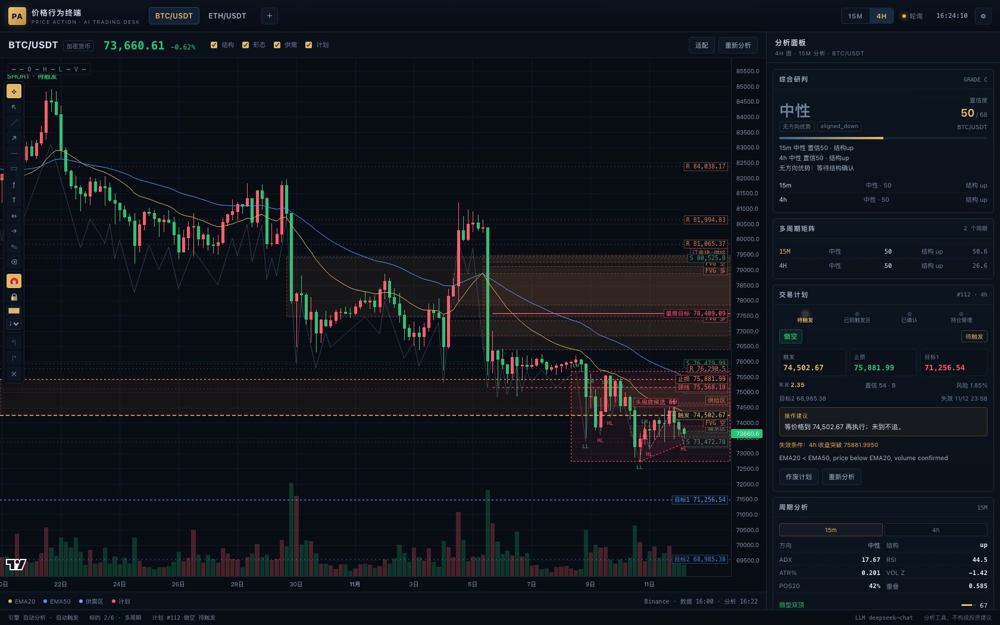
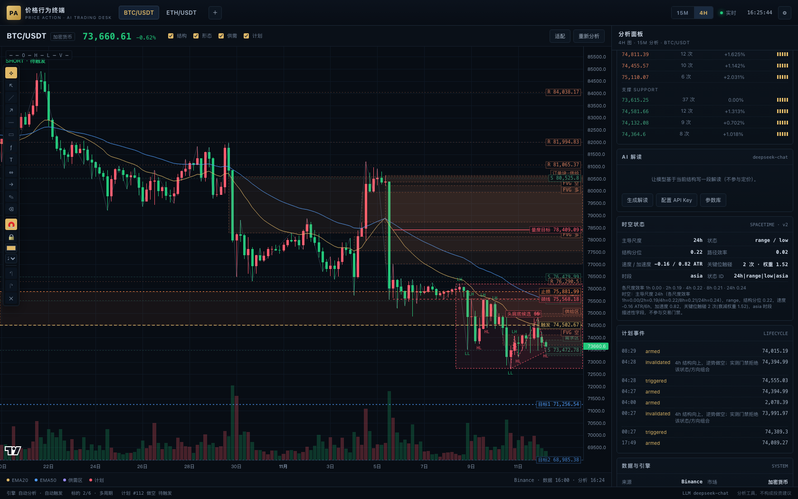
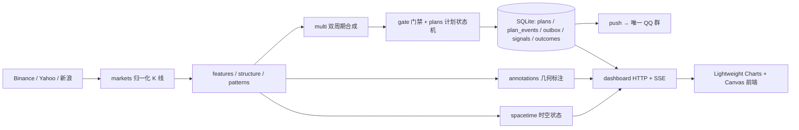
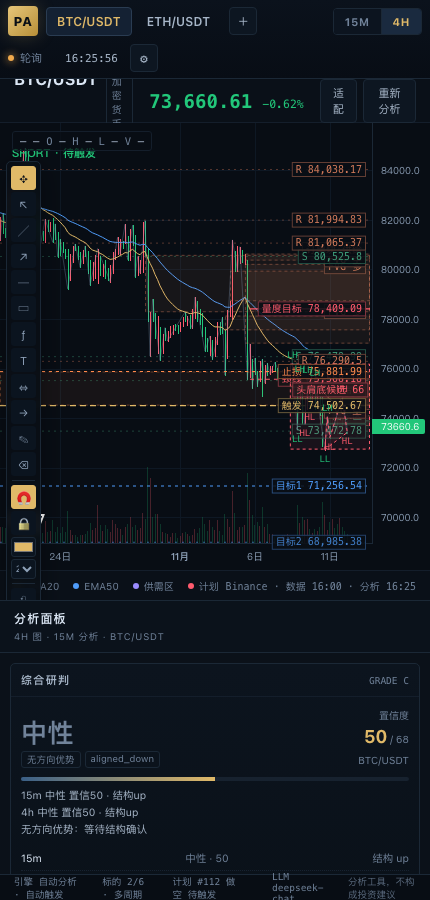

# naked-k-analysis · 价格行为分析终端

**把裸K价格行为从"看图说话"变成可追踪、可回测、可解释的工程系统。**

零第三方 Python 依赖（标准库 + SQLite + 本地 vendor 图表）的多市场终端：确定性分析引擎、双周期联合研判、几何标注、完整的交易计划生命周期、自适应时空状态，以及把**每一次状态切换**送达唯一 QQ 群的推送链路。

[](https://github.com/William-Trader/naked-k-analysis/actions/workflows/ci.yml)
[](https://www.python.org/)
[](CHANGELOG.md)
[](#工程约束)
[](#工程约束)
[](LICENSE)

> 分析工具，不构成投资建议。项目不执行交易、不承诺收益；**回测没有正期望时会如实写出来**。

---

## 先看界面

> 下图是 **2.3.0 生产实例的真实截图**（BTC/USDT，15m 图 + 4h 分析，非示意图）。



左侧是 K 线、EMA20/50、成交量、ATR ZigZag 摆动、支撑阻力聚类、趋势通道、供需区、形态多边形与计划价位线；右侧是综合研判、多周期矩阵、交易计划、周期分析、关键价位、AI 解读、计划事件与数据引擎状态。

---

## 为什么它不一样

| | 常见做法 | 本项目 |
|---|---|---|
| **信号** | 一次性的"买入/卖出"提示 | **有生命周期的计划**：`armed → triggered → confirmed → managing → closed`，每一步落库、可回放 |
| **到价** | 触价即视为入场 | 触价后**重跑一次完整分析**并过确认门；未通过直接作废，不裸触发 |
| **结论** | 靠 LLM 生成 | 确定性引擎定价，**LLM 只写解读**；价位永远来自规则 |
| **改进** | 调参直到回测好看 | 冻结快照 + 三段式 walk-forward + **样本外只评估一次** + 扰动压力验证 |
| **解释** | 黑箱分数 | 每个拒绝理由、每次状态切换、每个时空分量都能用中文说清依据 |

**「不交易」是一等公民输出**：中性/冲突时不出计划，置信不足不发确认，结构失效立即作废。计划状态与置信度是描述性质量分级，不是概率承诺。

---

## 核心能力

### 多市场，按需接入

| 市场 | 数据源 | 标的示例 | 周期 |
|---|---|---|---|
| 加密货币 | Binance public data | BTCUSDT / ETHUSDT / SOL / BNB / XRP | 15m / 1h / 4h / 1d |
| 大宗商品 | Yahoo Finance chart | GC / SI / HG / CL / NG / ZC / ZS | 15m / 1h / 4h / 1d |
| 海外指数/期货 | Yahoo Finance chart | SPX / NDX / DJI / ES / NQ / YM | 15m / 1h / 4h / 1d |
| 国内期货 | 新浪财经 JSONP | RB0 / I0 / CU0 / AU0 / SC0 / MA0 / TA0 | 15m / 1h / 4h / 1d |

默认只分析 **BTC / ETH**；其余标的在「系统设置 → 标的池」启用后才拉取。最大同时分析标的数可配（默认 6，上限 24）。

### 双周期联合分析

默认 **4h（环境/偏向）+ 15m（执行/时机）**，可切换单周期。周期共振才提高置信度；方向冲突降为中性并限制置信度；高周期反向可否决快速周期。每个周期独立输出方向、置信度、结构状态、ADX/RSI/ATR/Volume Z/位置、形态与关键位。

### 交易计划生命周期

```
armed(待触发) -> triggered(到触发区) -> confirmed(确认) -> managing(持仓管理) -> closed(结束)
      |                 |                     |
      +-----------------+---------------------+--> void(失效/超时/手动作废)
```

计划包含方向、触发价、止损、目标 1/2、R:R、失效条件、TTL 与分析快照。目标 1 达成自动移保本；每次状态迁移写入 append-only `plan_events` 并带幂等键，进程重启不会重复推送。

### 图表几何标注

服务端 `nakedk/annotations.py` 输出可绘制几何，前端用 Lightweight Charts + 透明 Canvas 叠加：ATR ZigZag 与 HH/HL/LH/LL、支撑阻力聚类、最小二乘趋势通道（R² 过滤 + 右延）、供需区与突破基座、双底双顶/头肩/三角形/楔形/旗形/杯柄多边形 + 颈线 + 量度目标、FVG 与订单块、当前计划的触发/止损/目标/风险区。另有 12 种绘图工具（趋势线、斐波那契、测量、文字、磁吸、撤销重做）按标的+周期持久化。

### 每个标的一套参数

`state/symbol_profiles.json` 保存每个标的的覆盖值、来源、版本与历史，改动只影响该标的。所有数值键都受 `symbol_params.BOUNDS` 硬边界约束；LLM 建议越界、非数字、未知键一律拒绝。

### LLM（可选，不参与定价）

支持任意 OpenAI 兼容接口（DeepSeek / OpenAI / 通义千问 / Moonshot / Ollama / vLLM）。面板 `⚙ → LLM → API Key` 可直接输入（存本机 `state/llm.key`，0600，不回显），或用 `NK_LLM_*` 环境变量覆盖。图表解读只输出一句话结论、情景、失效条件与风险提示；受限参数迭代仅在样本充足（总数 ≥20、已结束 ≥10）时提出 ≤2 项小幅调整，每天最多一次。未配置 key 时系统完整可用。详见 [docs/LLM.md](docs/LLM.md)。

### 全状态推送到唯一 QQ 群

**每一次可见状态变化都会推送**，且强制投递到**唯一**配置的群：

| 类别 | 事件 |
|---|---|
| 计划生命周期 | `armed` · `triggered` · `confirmed` · `tp1` · `tp2` · `stopped` · `invalidated` · `expired` |
| 市场状态 | 方向、结构状态、regime、多周期排列的**切换**（一条汇总消息，含前后值与依据） |
| 运行异常 | 确认门重分析失败（不再静默卡死） |

- `qq_target` 必须是**单个**群 ID：逗号/分号/空格/换行一律拒绝，不会误发到多个群。
- 消息格式为 `标的 · 周期 · 方向 / 状态 / 操作 / 触发·止损·目标 / 依据 / 风控 / 数据 + 免责声明`，不推心跳。
- outbox 具备**退避重试**（瞬时异常不再永久失败）、失败原因落库、按状态去重、静默时段只延迟不销毁、显式 `urgent` 让止损/失效/状态切换优先送达。
- 状态切换会持久化基线，**服务重启不重放**，相同切换按冷却去重。
- 本机无 qqbot 时可设 `push_ssh` 走远程网关；命令行参数逐项 quote，不做 shell 拼接。

前端通过 SSE `/api/stream` 接收 symbol/plan/settings 事件，并保留 25s 轮询兜底。

### 自动再分析

除按 TTL 刷新外，引擎还监控现价与支撑阻力、形态颈线、量度目标的距离；进入 `0.35 × ATR` 且超过冷却时间时立即重分析——**价格到达关键位会触发新的判断**，而不是等固定轮询。

---

## 时空分析体系（2.3.0）

不再把 15m/4h 写死为唯一观察窗口。`nakedk/spacetime.py` 从 1h 基础序列重聚合 1h/2h/4h/8h/1d，用「净位移 / 总路程」选出**当前主导尺度**，并给出结构分位、ATR 归一化速度/加速度、关键位触碰的时间衰减权重、UTC 时段与离散状态 ID。所有状态只使用 bar 收盘前的数据，无未来函数。



`NK_SPACETIME=1` 开启描述性字段（默认关闭、零额外请求、**不参与交易门禁**）。设计与验证结论见 [docs/SPACETIME.md](docs/SPACETIME.md)。

---

## 实测结果（可复现，不粉饰）

**730 天冻结快照 · BTCUSDT + ETHUSDT · 4h · 12bp 往返成本 · test 段只评估一次**

| 指标 | baseline | 采纳的 `v22` 门禁 | 变化 |
|---|---|---|---|
| 交易数 | 169 | **51** | −118（更克制） |
| 平均净收益 | −0.0125% | **+0.1162%** | +0.1287pp |
| 命中率 | 46.72% | **56.88%** | +10.16pp |
| 最大回撤 | −12.33% | **−5.11%** | 改善 7.22pp |

12 组扰动压力验证（成本 12/16/20/25bp、单标的、test 前后半段、参数邻域）**胜 11 组，91.7%**。选参用 train 50% / validation 25%，样本量 <30 不得参选，validation 连续无改善早停。通过 `NK_RESEARCH_GATE=1` 启用（默认关闭）。

更早的 150 天实测同样如实保留：基线命中 38.6% / 42.2%、平均净 −0.105% / −0.078%，3 折全负；加入高重叠硬否决与量能确认后 47.6% / 54.1%、−0.033% / +0.206%，第 3 折仍负。**项目不宣称正期望。**

> 「行业最优」不是一个可验证的口径，因此本项目不宣称它。这里提供的是可复现、可证伪、可解释的口径：所有数字都能从入库的冻结快照重新算出来。

```bash
PYTHONPATH=. python3 research/fetch_history.py     # 冻结快照（sha256 manifest 入库）
PYTHONPATH=. python3 research/run_backtest.py      # 三段式 walk-forward 选参
PYTHONPATH=. python3 research/verify_result.py     # 12 组扰动压力验证
PYTHONPATH=. python3 research/run_spacetime.py     # 时空体系对比
```

`research/data/*.json.gz` 与 `research/results/*.json` 全部入库，结论口径见 [docs/BACKTEST.md](docs/BACKTEST.md)、[docs/SPACETIME.md](docs/SPACETIME.md) 与 CHANGELOG。

---

## 架构



运行时两条循环：**analysis**（按 TTL / 到价触发，算特征并刷新计划，重）与 **trigger**（每 20s 只比较价格与计划价位，轻，触发后才做一次完整分析确认）。

主要模块：

```
nakedk/   analysis · markets · features · structure · patterns · annotations
          multi · plans · spacetime · symbol_params · research_gate · llm · backtest
beagle/   engine（编排）· store（SQLite）· push（唯一群投递）· score / review / replay
dashboard/ server.py（HTTP/SSE）· app/*.js（图表、面板、绘图、设置）
research/  fetch_history · run_backtest · verify_result · run_spacetime · data/ · results/
```

---

## 30 秒上手

```bash
git clone https://github.com/William-Trader/naked-k-analysis.git
cd naked-k-analysis
python3 dashboard/server.py          # Python 3.10+，无需 pip install
open http://127.0.0.1:8080/
```

首次启动自动建 `beagle.db` 与 `state/`。独立引擎：`python3 -m beagle.engine`（可与 dashboard 共用同一 SQLite）。

```bash
PYTHONPATH=. python3 -m nakedk fetch BTCUSDT XAU
PYTHONPATH=. python3 -m nakedk signal XAU
PYTHONPATH=. python3 -m nakedk knowledge '突破回踩'
python3 -m unittest discover -s tests        # 307 passing
```

### 安全默认值

**dashboard 默认只绑 `127.0.0.1`**，CORS 默认不开放，500 不再回显 traceback，静态资源在开启 token 后仍可加载（不会白屏）。对外暴露必须显式设置：

```bash
NK_DASH_HOST=0.0.0.0 \
NK_DASH_TOKEN='<强随机 token>' \
PORT=8081 python3 dashboard/server.py
```

访问 `http://host:8081/?token=<token>`；API 也支持 `Authorization: Bearer <token>`。生产部署清单见 [deploy/INVENTORY.md](deploy/INVENTORY.md)。

### 环境变量

| 变量 | 作用 | 默认 |
|---|---|---|
| `PORT` / `NK_DASH_HOST` | 端口 / 监听地址 | `8080` / `127.0.0.1` |
| `NK_DASH_TOKEN` | Bearer 或查询 token | 空（不鉴权） |
| `NK_DASH_CORS_ORIGINS` | 允许的来源，逗号分隔；`*` 允许全部 | 空（禁跨域） |
| `BEAGLE_DB` | SQLite 路径（**所有组件共用**） | `<repo>/beagle.db` |
| `NK_SETTINGS` / `NK_SYMBOL_PROFILES` | 设置 / 标的参数库 | `<repo>/state/…` |
| `NK_RESEARCH_GATE` | 启用经样本外验证的 `v22` 门禁 | 关闭 |
| `NK_SPACETIME` | 输出时空描述字段 | 关闭 |
| `NK_MARKET_BASE` | 行情端点（可切镜像） | `data-api.binance.vision` |
| `NK_LLM_CONFIG` / `NK_LLM_KEY` / `NK_LLM_KEY_FILE` | LLM 配置与密钥 | 见 `config/llm.example.json` |
| `NK_LLM_BASE` / `NK_LLM_MODEL` | OpenAI 兼容端点 / 模型 | 配置文件 |
| `BEAGLE_QQ_TARGET` | **唯一**推送群目标 | 空（不推） |
| `BEAGLE_PUSH_SSH` | 通过远程网关发送的 SSH host | 空（本机） |

---

## API

| Endpoint | 说明 |
|---|---|
| `GET /api/health` | 服务 / 引擎 / LLM / 计划统计（含版本号） |
| `GET /api/universe` · `/api/overview` · `/api/symbol` | 标的池 · 多标的概览 · 单标的完整分析 |
| `GET /api/plans` · `/api/events` · `/api/knowledge` | 计划台账 · 事件 · 知识库 |
| `POST /api/analyze` · `/api/plan/action` | 立即重算 · 手动作废 |
| `GET/POST /api/settings` · `/api/symbol-params` | 设置 · 标的参数读写/建议/回滚 |
| `GET /api/llm/status` · `POST /api/llm/annotate` · `/api/llm/optimize` | LLM 状态与受限能力 |
| `GET/POST /api/drawings` · `GET /api/stream` | 绘图持久化 · SSE 实时事件 |

---

## 工程约束

1. **零第三方依赖**：Python 标准库 + SQLite；图表库本地 vendor（Apache 2.0，见 `NOTICE.md`）。
2. **单一分析路径**：dashboard / CLI / 引擎都调用 `nakedk/analysis.py`，不各自推导。
3. **单一计划事实源**：前端与 QQ 都读同一个 plan / plan_event，避免「群里说 A、页面说 B」。
4. **单一数据库**：`BEAGLE_DB` 统一计划、事件、信号、结果与评分链路。
5. **幂等**：`plan_events.idempotency_key` + `outbox(plan_event_id, channel)` 唯一约束。
6. **门禁只做减法**：新增过滤必须有实测依据；不因「看起来更好」而放宽。
7. **测试只增不减**：307 个单测全绿，新增模块必须带测试。
8. **安全默认值**：默认绑本机、默认禁跨域、默认不启用可选分析层。

---

## 移动端



---

## 致谢

价格行为方法论来自 Al Brooks（趋势/区间/反转三部曲、Always-In、Setup）、YTC / Lance Beggs、许佳聪《裸K线交易法》、胡云生《裸K线技术分析与交易》、崔海军《裸K线操盘技法》、陈浩筹码分布、Adam Grimes、Wyckoff。项目只做蒸馏与工程化，原著版权归原作者。

---

## License

[Personal Use & Group Exchange License](LICENSE)。**仅供个人使用与团体交流；禁止商业用途。**

水印（`WM: NKA-XXXXXXXX`）是部分核心文件的来源标记，并非覆盖全部源文件；已标记清单见 [WATERMARK.md](WATERMARK.md)。新增文件改用 SPDX 头。
